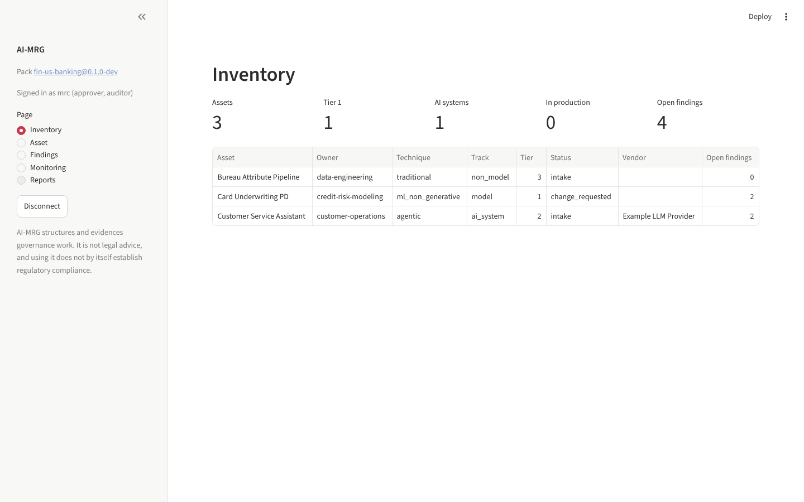
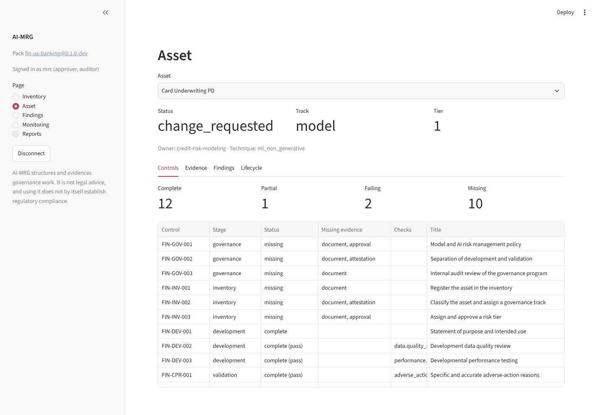
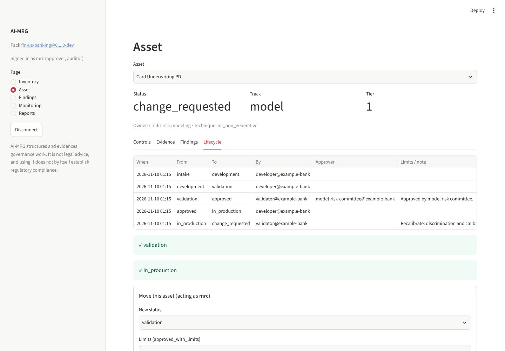
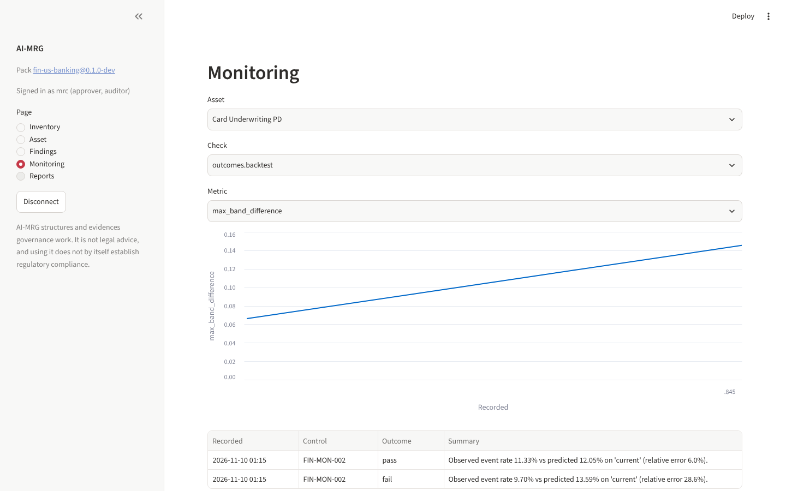

# Dashboard

A web interface for model owners, validators, approvers and auditors who would rather
not use the command line.

```bash
pip install -e ".[api,dashboard]"
aimrg serve &                                   # the REST API
aimrg dashboard --api-url http://127.0.0.1:8000 # opens on http://127.0.0.1:8501
```

Or start everything with [Docker Compose](deployment.md#everything-in-containers-docker-compose).

Sign in with an API token from `aimrg user add`. The dashboard talks only to the REST API
([ADR-0004](adr/0004-streamlit-first-dashboard.md)), so **roles and the workflow's
independence rules apply to every action**. A validator who tries to accept risk is
refused, and an approver who recorded development evidence can't approve the asset. The
reason is shown on the page.

## Pages

| Page | What you can do |
|---|---|
| **Inventory** | Portfolio summary (assets, tier 1, AI systems, in production, open findings) and the full inventory |
| **Asset** | Status, track and tier; **Controls**: coverage of every required control; **Evidence**: list and record documents or attestations (with attachments); **Findings**: open, close with evidence, accept risk; **Lifecycle**: history, what blocks each next step, and moving the asset |
| **Findings** | All open findings with age and how overdue they are |
| **Monitoring** | Trend of any check metric over time (e.g. PSI, Gini drop, back-test error) with outcomes |
| **Reports** | Preview and download any report as Markdown or Word; auditors can build the examination package |

Deep links open a page directly: `http://127.0.0.1:8501/?page=Asset&asset=Card%20Underwriting%20PD`.









*Screenshots use the simulated data from `examples/credit-scorecard`.*
